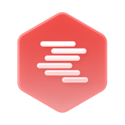

<h1>
  
  &nbsp;lmstudio
</h1>
Hub service for LM Studio's OpenAI-compatible local server.

Set `LMSTUDIO_BASE_URL` if LM Studio is not running at `http://localhost:1234/v1`.

To install dependencies:

```bash
bun install
```

To run:

```bash
bun run index.ts
```

This project was created using `bun init` in bun v1.2.10. [Bun](https://bun.sh) is a fast all-in-one JavaScript runtime.

## Service reference

### What it does

hub-lmstudio shares the models of an [LM Studio](https://lmstudio.ai) running on this machine with a hub. Callers send
a chat request to `llm/local` and get the reply at once or as a stream; `llm/list` lists the loaded models. It talks
to LM Studio's OpenAI-compatible local server (`/v1/chat/completions`, `/v1/models`), so answers come in OpenAI's chat
completion shapes. The request takes the shape [hub-ollama](https://github.com/v57/hub-ollama)'s `llm/local` takes
(`model`, `messages`, `options`, `keep_alive`), so a caller can send the same request to either. Run it on several
machines and the hub splits the calls between them; the hub runs at most 4 calls at once on each.

### Installing it on a Hub

LM Studio must be running on the same machine (or at `LMSTUDIO_BASE_URL`) with its local server started and a model
loaded.

**From the launcher.** The launcher's app catalogue (hub-store `apps.json`) doesn't list it yet. An owner adds it in
the Hub app: **Launcher**, **New App**, **Bun**, with repository `v57/hub-lmstudio` (see the Hub app guide's
[Launcher](https://github.com/v57/hub-app/blob/main/docs/Launcher.md) page). The launcher on the hub's machine clones
it into its `apps/` folder (`~/Hub/Launcher/apps/hub-lmstudio` when it was started with the
[`hub`](https://github.com/v57/hub) CLI), runs `bun install --production --frozen-lockfile` and starts it with `bun .`.
The owner call behind it is `launcher/app/create { name, type: 'bun', repo: 'v57/hub-lmstudio', active: true }`. To
use another machine's LM Studio, install it on that machine's launcher, or run it there by hand.

**By hand:**

```sh
git clone https://github.com/v57/hub-lmstudio.git && cd hub-lmstudio
bun install
HUB=ws://127.0.0.1:1997 bun .
# or pass the hub's address as the first argument: bun . ws://127.0.0.1:1997
```

Configuration:

| Name | Kind | What |
| --- | --- | --- |
| `HUB` | environment | The hub's address. A bare number is a port on this machine. Default `1997`. |
| first argument | argument | The hub's address; wins over `HUB`. |
| `LMSTUDIO_BASE_URL` | environment | LM Studio's OpenAI-compatible server. Default `http://localhost:1234/v1`. |
| `LMSTUDIO_API_KEY` | environment, secret | Sent as `Authorization: Bearer ...` when set, for an LM Studio that asks for a key. With the launcher, add it under **Secret keys**. |
| `auth` | file in the working directory | The service's own key, created on the first run. Keep it: the hub approves the service by this key. |

The hub-service SDK reads a few more variables (device key, instance name); see the
[hub-service README](https://github.com/v57/hub-service).

**Hosting approval.** When the service connects, it asks the hub to post `llm/local` and `llm/list`. The hub routes no
calls to it until an owner allows that: the Hub app lists the paths as **Needs approval** on **Services** and the
request on **Requests**, where **Allow** approves exactly those paths for the service's key. The owner call behind it
is `hub/host/update { key, allow: [paths] }`. A service whose key is an owner's needs no approval.

### APIs

The descriptions come from `descriptions.ts`, which the service sends to the hub; `hub/api/list` returns them (the Hub
protocol, `Docs/Devices/protocol.md` section 15 in the Hub workspace).

| Path | Kind | Title | Takes | Returns |
| --- | --- | --- | --- | --- |
| `llm/local` | post | Chat with a local model | a chat request | one OpenAI `chat.completion`: the reply in `choices[0].message`, with `usage` |
| `llm/local` | stream | Stream a chat with a local model | a chat request | OpenAI `chat.completion.chunk` values, the next piece in `choices[0].delta`; ends at LM Studio's `[DONE]` |
| `llm/list` | post | List local models | nothing | OpenAI's model list, `{ object: 'list', data: [{ id, object, owned_by }] }` |

The chat request is `{ model, messages, options?, keep_alive?, stream?, ... }`:

- `model` is an `id` from `llm/list`; `messages` are OpenAI chat messages (`role`, `content`, and `tool_calls` or
  `tool_call_id` for tool use; `content` may be text or OpenAI content parts, including `image_url` for vision models).
- `options` keys (use OpenAI names: `temperature`, `top_p`, `max_tokens`, `seed`, `stop`) move to the top level unless
  the request already sets them. `keep_alive` is accepted for hub-ollama compatibility and ignored. `stream` is
  ignored: the kind of call decides.
- Every other key, such as `temperature`, `max_tokens`, `tools` or `response_format`, goes to LM Studio as it is.
- Calls fail with `LM Studio request failed with HTTP <status>` and the start of LM Studio's answer when LM Studio
  refuses the request, or with a fetch error when it isn't running.

hub-ollama serves the same paths with Ollama's answer shapes. On a hub where both run, the hub splits `llm/local` and
`llm/list` calls between them, so a caller may get either shape; `hub/api/list` shows the description of the provider
that described the path first. Keep one of them per hub, or make callers handle both. The same goes for several
machines running hub-lmstudio: `llm/list` answers from one of them, so load the same models on each.

### Permissions

Both paths are guarded by a permission of their own path (`access.ts`): before the handler runs, the service asks the
hub with `hub/grant/check` whether the caller holds a grant of `llm/local` (or `llm/list`). The post and the stream of
`llm/local` share the one permission.

| Caller | `llm/local` (post and stream), `llm/list` |
| --- | --- |
| Anonymous (no key) | refused, `unauthorized` |
| A key or device without a grant | refused, `forbidden` |
| An owner of the hub | allowed |
| A caller an owner granted the path (or a prefix of it) | allowed |

This holds on every hub. On a `default-deny` hub (every new hub starts in it) the hub also refuses ungranted callers
before the call reaches the service; on an older `default-allow` hub the service's own check is what stops them. The
Hub app shows the permission as **Run models**.

To let another device run models, an owner adds a grant (Hub protocol section 6):

```
hub/grant/add { "subject": { "device": "<device id>" }, "object": { "prefix": "llm/" } }
```

`subject` may also be `{ "key": "<public key>" }`, `{ "group": "<group>" }` or `{ "everyone": true }`; `object` may be
`{ "path": "llm/list" }` for one path. In the Hub app, the same is **Grant** on a device's **Access** list. The check
reads grants, so give access with a grant.

### Testing

```sh
bun install
bun test
```

- `access.test.ts` checks that every path `index.ts` registers is guarded, and that anonymous and ungranted callers are
  refused while owners and granted callers pass (the hub's grant check is stubbed).
- `descriptions.test.ts` checks that every registered path and kind is described, and that the schemas stay in the
  subset hub-service accepts (hub-service `docs/api-descriptions.md`).

No test talks to LM Studio. To try it, start LM Studio's local server with a model loaded, run the service against a
local hub, approve it, and call `llm/list`, then `llm/local`.
